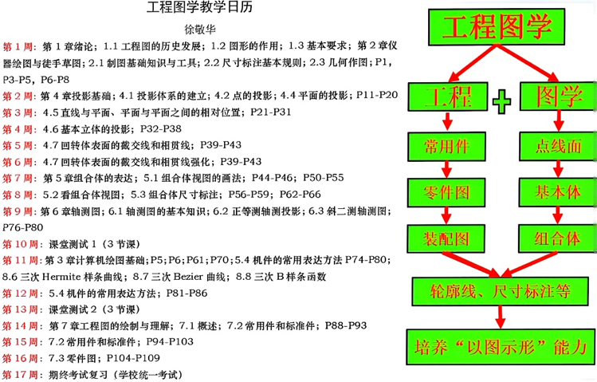

---
tags:
- 能环
- 储能
- 车辆
- 过控
---

# 工程图学 {#_1}

## 课程信息 {#course-information}

| 课程名称／课程号 | 适用范围与修读要求 |
| --- | --- |
| 工程图学 <small>ME1001F</small> | 能环、过控、车辆 · 25级及以前、26级 **专业基础必修**  储能普通班 · 26级 **专业基础必修** |
| 工程图学（H） <small>ME1001FH</small> | 慧能 · 25级及以前 **专业基础必修**  储能卓工班 · 26级 **专业基础必修** |

工程图学与工程图学（H）共用资料页。以下资料来自普通版（ME1001F），保留原作者署名；H版（ME1001FH）可参考相关内容，教学与考核以当期安排为准。

## 课程内容 {#_2}

### 分数构成 {#_3}

平时20% + 阶段测验20% + 考试60%

### 课程大纲 {#_4}

??? abstract "展开查看"

    

## 课程资源 {#_5}

### 推荐教材/网课 {#_6}

- [**Savia的网站**](https://savia7582.github.io/Exterior/Engineering/graphics/)

### 资源文件 {#_7}

- [**工程图学**](https://pan.baidu.com/s/1MjBWuIVlYb5VZVVkKSw6rg?pwd=vkcj)

### 学习笔记 {#_8}

## 学习建议 {#_9}
