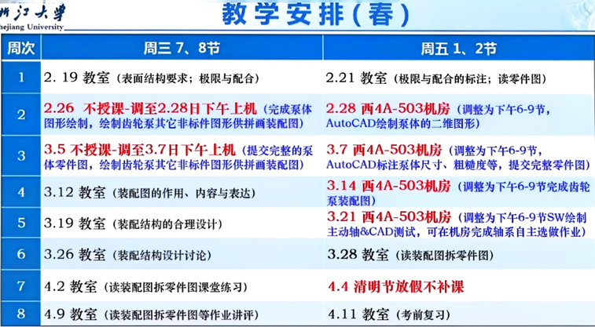

---
tags:
- 能环
- 车辆
- 过控
---

# 机械制图及CAD基础 {#cad}

## 课程信息 {#course-information}

| 课程名称／课程号 | 适用范围与修读要求 |
| --- | --- |
| 机械制图及CAD基础 <small>ME1103F</small> | 能环、过控 · 25级及以前、26级 **专业基础必修**  车辆 · 25级及以前 **专业基础必修** |

## 课程内容 {#_1}

### 分数构成 {#_2}

平时40% + 期末60%

### 课程大纲 {#_3}

??? abstract "展开查看"

    

## 课程资源 {#_4}

### 推荐教材/网课 {#_5}

### 资源文件 {#_6}

### 学习笔记 {#_7}

## 学习建议 {#_8}

## 学习资料链接 {#external-learning-resources}

CC98 原帖需登录访问。

- [机械制图及CAD基础：复习整理与参考样卷](https://www.cc98.org/topic/6160010) — myicing
     <small>2024–2025春；机械制图及CAD基础</small>
     含个人整理、参考样卷和零件图练习入口，原帖注明了引用资料。

- [机械制图及CAD基础：2025–2026春夏题型回忆](https://www.cc98.org/topic/6563929) — 红云irch
     <small>2025–2026春夏</small>
     记录尺寸标注、标准件改错与CAD操作等部分题型，属于文字回忆。
