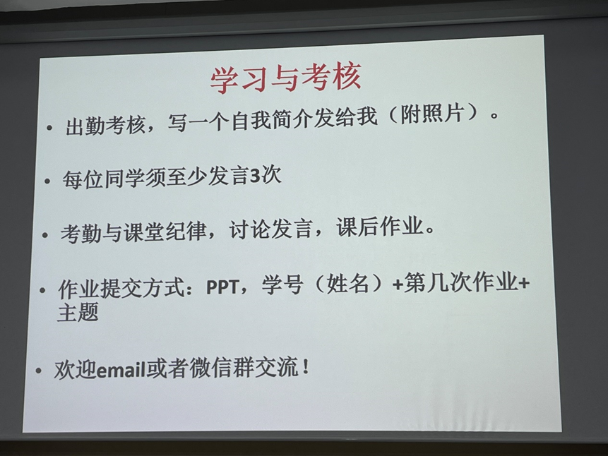

---
tags:
- 能环
- 储能
- 新能源
---

# 太阳能 {#_1}

## 课程信息 {#course-information}

| 课程名称／课程号 | 适用范围与修读要求 |
| --- | --- |
| 太阳能 <small>ENER3063M</small> | 新能源 · 25级及以前、26级 **专业必修 · 方向必修**  慧能 · 25级及以前 **专业选修 · 导师推荐选修**  储能卓工班 · 26级 **专业选修（项目2）** |

## 课程内容 {#_2}

### 分数构成 {#_3}

没有考试，具体考核要求见下图

### 课程大纲 {#_4}

> 待补充

## 课程资源 {#_5}

### 推荐教材/网课 {#_6}

### 资源文件 {#_7}

### 学习笔记 {#_8}

## 学习建议 {#_9}
