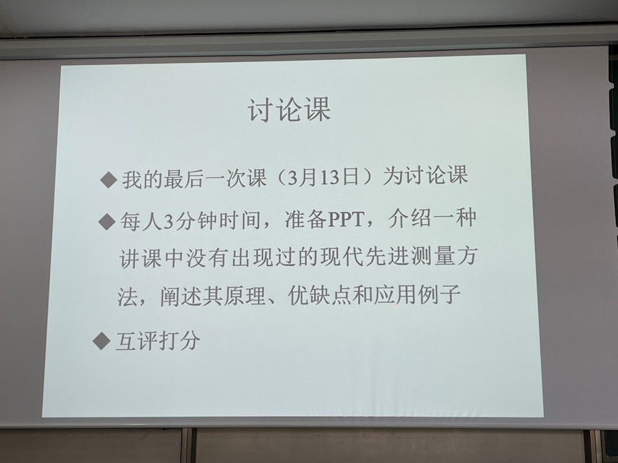

---
tags:
- 能环
- 车辆
- 新能源
---

# 新能源系统检测与控制 {#_1}

## 课程信息 {#course-information}

| 课程名称／课程号 | 适用范围与修读要求 |
| --- | --- |
| 新能源系统检测与控制 <small>ENER3051M</small> | 新能源 · 26级 **专业选修 · 模块选修**  车辆 · 26级 **专业选修 · 模块选修（绿色动力）**  新能源 · 25级及以前 **专业选修 · 模块必修** |

## 课程内容 {#_2}

### 分数构成 {#_3}

平时（30-40），期末闭卷（60-70）

分为王飞老师和黄群星老师两个人上（各上8节课），王飞每节课会留思考题（作业），期末会考这些题，第四周结束时统一一起交；王飞老师的左后一节课是展示课，个人展示，每人3分钟左右，只用讲一种现代测量技术就行；每节课都会口头点名

展示要求见下图：

### 课程大纲 {#_4}

## 课程资源 {#_5}

### 推荐教材/网课 {#_6}

### 资源文件 {#_7}

- [**新能源系统检测与控制**](https://pan.baidu.com/s/1XZSjk2RwfFx8lyu7pVqN4Q?pwd=rkqy)

### 学习笔记 {#_8}

=== "李张硕"

    

    

    <object data="笔记bylzs.pdf" type="application/pdf" aria-labelledby="PDF document">
        <embed src="笔记bylzs.pdf" type="application/pdf" />
        

            Your browser does not support PDFs
            <a href="笔记bylzs.pdf" class="image fit">下载笔记</a>
        

    </object>

    

=== "qqyz复习提纲2025"

    

    

    <object data="新能源系统与检测复习提纲2025.pdf" type="application/pdf" aria-labelledby="PDF document">
        <embed src="新能源系统与检测复习提纲2025.pdf" type="application/pdf" />
        

            Your browser does not support PDFs
            <a href="新能源系统与检测复习提纲2025.pdf" class="image fit">下载笔记</a>
        

    </object>

    

=== "燕天润"

    

    

    <object data="新能源系统控制与检测by燕天润.pdf" type="application/pdf" aria-labelledby="PDF document">
        <embed src="新能源系统控制与检测by燕天润.pdf" type="application/pdf" />
        

            Your browser does not support PDFs
            <a href="新能源系统控制与检测by燕天润.pdf" class="image fit">下载笔记</a>
        

    </object>

    

## 学习建议 {#_9}
