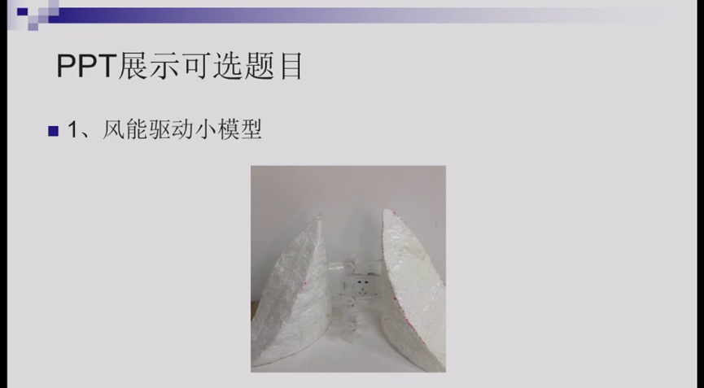
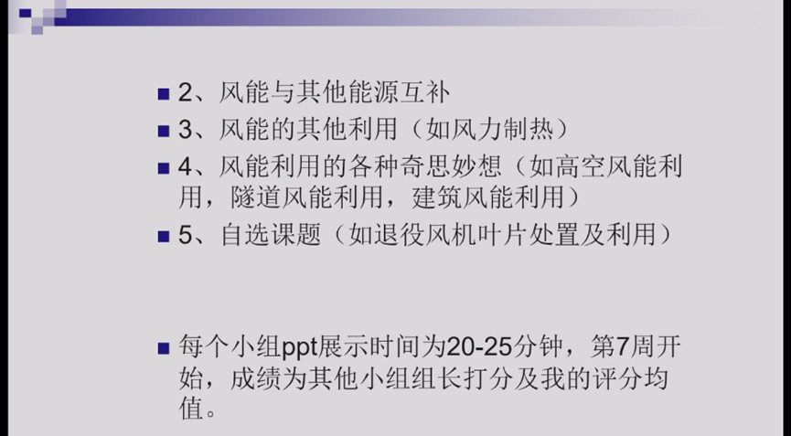

---
tags:
- 能环
- 储能
- 新能源
---

# 风能 {#_1}

## 课程信息 {#course-information}

| 课程名称／课程号 | 适用范围与修读要求 |
| --- | --- |
| 风能 <small>ENER3029M</small> | 新能源 · 25级及以前、26级 **专业必修 · 方向必修**  慧能 · 25级及以前 **专业选修 · 导师推荐选修**  储能卓工班 · 26级 **专业选修（项目2）** |

## 课程内容 {#_2}

### 分数构成 {#_3}

平时（30-40），期末闭卷（60-70）

目前为止只有两次作业，几乎每节课都会点名，第七周有一次展示，老师直接按名单分组，展示要求见下图

 

### 课程大纲 {#_4}

## 课程资源 {#_5}

### 推荐教材/网课 {#_6}

### 资源文件 {#_7}

- [**风能**](https://pan.baidu.com/s/1CegzIqMYfH7gAEO0m_WHaQ?pwd=7xur)

### 学习笔记 {#_8}

=== "笔记by李张硕"

    

    

    <object data="笔记bylzs.pdf" type="application/pdf" aria-labelledby="PDF document">
        <embed src="笔记bylzs.pdf" type="application/pdf" />
        

            Your browser does not support PDFs
            <a href="笔记bylzs.pdf" class="image fit">下载笔记</a>
        

    </object>

    

=== "提纲by李张硕"

    

    

    <object data="提纲bylzs.pdf" type="application/pdf" aria-labelledby="PDF document">
        <embed src="提纲bylzs.pdf" type="application/pdf" />
        

            Your browser does not support PDFs
            <a href="提纲bylzs.pdf" class="image fit">下载笔记</a>
        

    </object>

    

=== "笔记by谢佳含"

    

    

    <object data="笔记byxjh.pdf" type="application/pdf" aria-labelledby="PDF document">
        <embed src="笔记byxjh.pdf" type="application/pdf" />
        

            Your browser does not support PDFs
            <a href="笔记byxjh.pdf" class="image fit">下载笔记</a>
        

    </object>

    

## 学习建议 {#_9}
